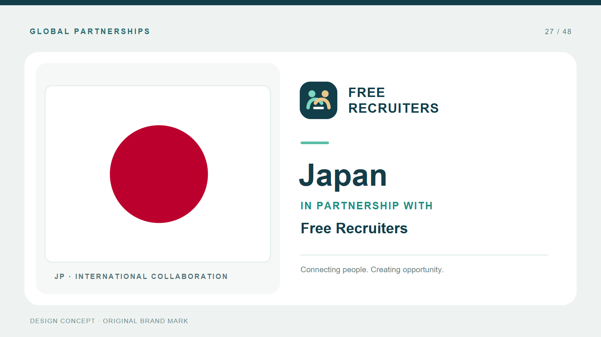

# Free Recruiters · Global Partnership Concept

An **independent portfolio concept** for an international recruiting brand. It contains an original logo mark and a consistent 1600 × 900 partnership card for each unique country in a sample brief. The Toptal logo shown in the supplied reference is not used.



[View the overview of all 48 cards](contact-sheet.jpg) · [Download the complete SVG and PNG series](free-recruiters-design-concept.zip)

## Deliverables

- `output/free-recruiters-logo.svg` and `.png` — original brand concept
- `output/svg/` — 48 editable, self-contained SVG cards
- `output/png/` — matching PNG cards at 1600 × 900 pixels
- `output/contact-sheet.jpg` — overview of the series

The source list contained **49 entries but 48 unique countries**, because Vietnam was listed twice. Two additional countries would need to be specified to reach 50 distinct versions.

## Build

Install the flag source package and run the generator:

```powershell
npm install
python -m pip install -r requirements.txt
python generate.py
```

The generated cards embed the flag artwork directly and do not fetch images from a server when opened. The flag artwork comes from [flag-icons](https://github.com/lipis/flag-icons), copyright Panayiotis Lipiridis and contributors, under the MIT license; see `THIRD_PARTY_LICENSES.md`.

This is a design demonstration, not an assertion of any actual partnership between Free Recruiters and the listed countries or governments. Brand names are used solely to illustrate the requested layout.
